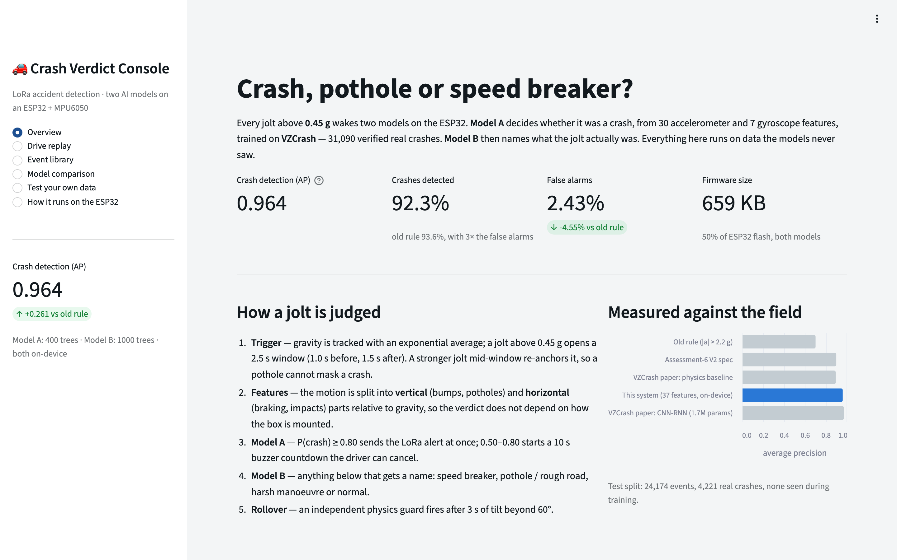
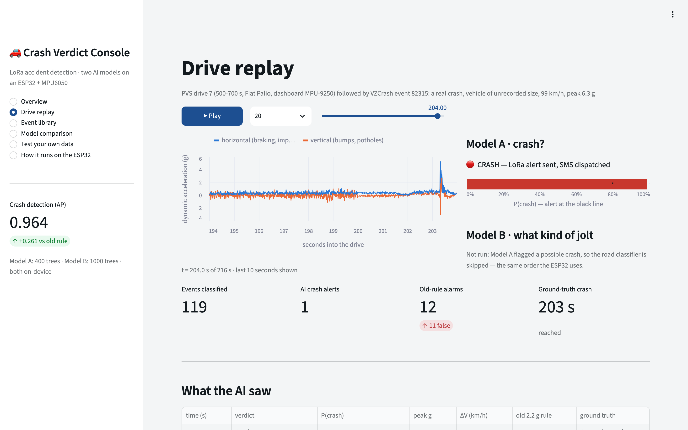
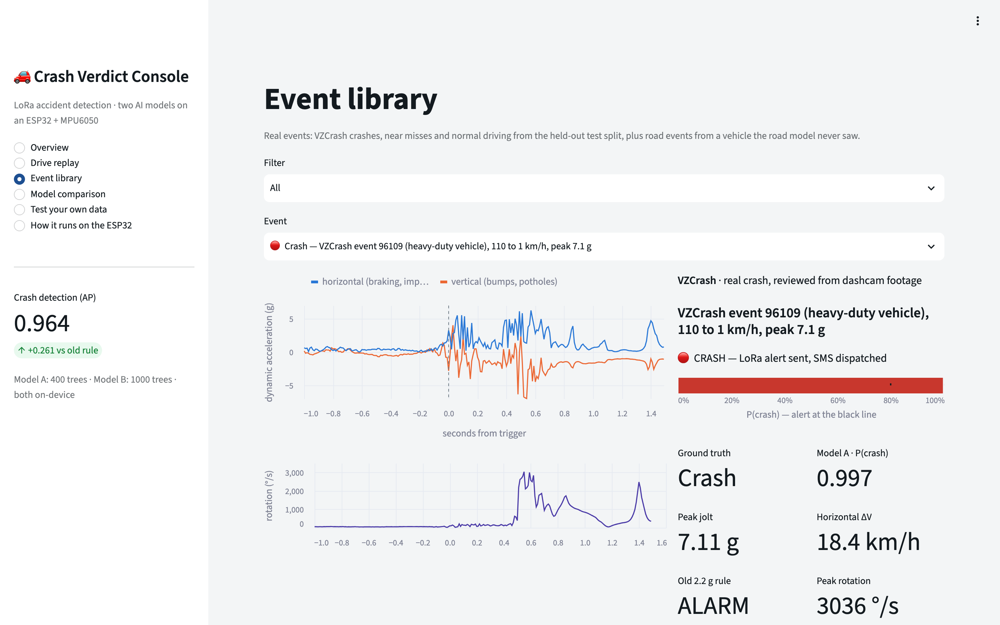

# Accident Detection and Emergency Alert System

Vehicle accident detection using an ESP32, an MPU6050 IMU and LoRa. The transmitter in the vehicle detects a crash and sends an alert over LoRa (433 MHz) to a receiver, which sends an SMS to an emergency contact over WiFi.

Features:
- Crash detection on the ESP32 itself (rule based, or the ML model described below)
- Long range LoRa link between vehicle and base station
- SMS alerts through the CircuitDigest Cloud API
- CSV logging over Serial for collecting data
- WiFi auto reconnect on the receiver



## Crash classifier (crash vs speed breaker vs pothole)

Not every jolt is an accident, so `transmitter_LORA/ml_crash_detector` runs two models on the ESP32. Any jolt above 0.45 g opens a 2.5 s window. Model A decides if it was a crash, and if not, model B says what it was.

| | Model A (crash detector) | Model B (road event classifier) |
|---|---|---|
| Trained on | VZCrash, 31,090 real on-road crashes | PVS drives + Driver Behavior dataset |
| Inputs | 30 accelerometer + 7 gyroscope features | 30 accelerometer features |
| Output | P(crash) | NORMAL / SPEED_BUMP / POTHOLE_ROUGH_ROAD / HARSH_MANEUVER |
| Algorithm | LightGBM (400 trees) | XGBoost (250 rounds x 4 classes) |

Results on the VZCrash test split (24,174 events, 4,221 crashes not used in training):

| Per event, at the alert threshold | Old rule (`impact > 2.2 g`) | Assessment-6 V2 design | This system |
|---|---|---|---|
| Average precision | 0.703 | 0.902 | **0.964** |
| Crashes detected | 93.6 % | 84.3 % | **92.3 %** |
| False alarms | 6.98 % | 3.63 % | **2.43 %** |

For comparison, the deep network from the VZCrash paper (1.7 M parameters) gets 0.976 AP and its physics baseline gets 0.896.

How the alert is decided:
- P(crash) >= 0.80: LoRa `ALERT` is sent straight away
- 0.50 to 0.80: 10 s buzzer countdown, the driver can cancel it with the button
- below 0.50: logged, and optionally sent as an `EVENT` packet (the receiver logs it, no SMS)
- separately, `ROLLOVER` is sent if the vehicle stays tilted past 60° for 3 s

More details:
- Results and limitations: [ml/results/REPORT.md](ml/results/REPORT.md)
- Retraining: [ml/README.md](ml/README.md)
- Streamlit app: `streamlit run streamlit_app.py` (deploy notes in [app/README.md](app/README.md))
- HTML dashboard: open `demo/index.html` in Chrome or Edge and use **ESP32 over USB -> Connect ESP32** to stream live data over Web Serial

Flashing the ML transmitter: open `transmitter_LORA/ml_crash_detector/ml_crash_detector.ino` with the `MPU6050` (Electronic Cats) and `LoRa` (Sandeep Mistry) libraries installed. Buzzer goes on GPIO 4 and the cancel button between GPIO 13 and GND. It uses 659 KB of flash (50 %) and 45 KB of RAM. `reciever_sms.ino` includes the model's verdict and confidence in the SMS.

| Drive replay | Event library |
|---|---|
|  |  |

## Running it

You need Python 3.10+ and Git. No datasets are needed to run the app.

```bash
git clone https://github.com/Arush-O7/Smart-Accident-Detection-Emergency-Alert-System.git
cd Smart-Accident-Detection-Emergency-Alert-System
python -m venv .venv
```

Activate the venv (Windows: `.venv\Scripts\activate`, macOS/Linux: `source .venv/bin/activate`), then:

```bash
pip install -r requirements.txt
streamlit run streamlit_app.py
```

The app opens at http://localhost:8501.

| Part | What you need |
|---|---|
| Streamlit app | the commands above |
| HTML dashboard with live ESP32 | open `demo/index.html` in Chrome or Edge |
| Firmware | Arduino IDE, ESP32 board package, **MPU6050** (Electronic Cats) and **LoRa** (Sandeep Mistry) libraries |
| Retraining | `pip install -r ml/requirements.txt` and follow [ml/README.md](ml/README.md) (around 8 GB of data and a free HuggingFace account). On macOS run `brew install libomp` first |

## System architecture

```
 Vehicle (transmitter)                      Base station (receiver)
 +-----------+      +---------------+       +----------------------+
 |  MPU6050  | ---> | ESP32 + LoRa  | ~~~~> |    ESP32 + LoRa      | ---> WiFi ---> SMS API ---> phone
 +-----------+      | crash logic   | 433MHz| receive, send SMS    |
                    +---------------+       +----------------------+
```

## Project structure

```
transmitter_LORA/
  transmitter_LORA.ino              basic transmitter
  angular_rotation_crash/           rule based transmitter
  ml_crash_detector/                ML transmitter
    ml_crash_detector.ino
    crash_features.h                30 accel + 7 gyro features
    crash_model.h                   model A
    road_model.h                    model B
Reciever_LORA/
  Reciever_LORA.ino                 basic receiver
  reciever_sms/reciever_sms.ino     receiver with SMS
ml/                                 datasets, training, export
streamlit_app.py                    Streamlit app
app/                                app engine + exported models
demo/                               HTML dashboard
```

## Hardware

Transmitter (vehicle):
- ESP32
- MPU6050
- SX1278 LoRa module (433 MHz)
- Power supply

Receiver (base station):
- ESP32
- SX1278 LoRa module (433 MHz)
- WiFi (mobile hotspot or router)
- USB / 5V supply

Pin connections (same on both boards):
```
LoRa (SPI)
CS/SS  GPIO 5
RST    GPIO 14
DIO0   GPIO 26
MOSI   GPIO 23
MISO   GPIO 19
SCK    GPIO 18

MPU6050 (transmitter only)
SDA    GPIO 21
SCL    GPIO 22
```

## Rule based detection

`angular_rotation_crash.ino` uses four conditions:

| Type | Condition |
|---|---|
| High impact crash | `impact > 2.2g` |
| Angled crash | `impact > 2.2g` and `rotation_rate > 100°/s` |
| Rollover | `abs(pitch) > 75°` or `abs(roll) > 75°` |
| Extreme rotation | `rotation_rate > 180°/s` |

The transmitter sends an `ALERT` packet when one of these is true, with a 3 s cooldown. The receiver sends one SMS per alert and resets when it gets a `CLEAR` packet.

Raw MPU6050 values are converted with `value / 16384.0` for g and `value / 131.0` for °/s.

## Data logging

The transmitter prints CSV on the Serial Monitor:

```
ax,ay,az,gx,gy,gz,impact,rotation,pitch,roll,label
0.15,-0.02,1.00,5.23,-2.10,1.45,1.02,6.5,8.3,1.2,0
2.85,1.92,2.15,125.4,92.3,-48.2,3.48,145.2,42.1,-28.5,1
```

`ax..az` in g, `gx..gz` in °/s, `impact` and `rotation` are the vector magnitudes, `pitch`/`roll` in degrees, `label` is 0 for normal and 1 for accident.

## Setup

1. Wire up the transmitter and receiver as per the pins above.
2. Install the [Arduino IDE](https://www.arduino.cc/en/software) and the ESP32 board package.
3. Install the libraries from **Sketch -> Include Library -> Manage Libraries**: `MPU6050`, `LoRa` (Sandeep Mistry). `WiFi` and `HTTPClient` come with the ESP32 package.
4. Flash the transmitter. `transmitter_LORA/transmitter_LORA.ino` for a basic test, `angular_rotation_crash/angular_rotation_crash.ino` for the rule based version, or `ml_crash_detector/` for the ML version. Board: ESP32 Dev Module, Serial Monitor at 115200.
5. Flash the receiver. `Reciever_LORA/Reciever_LORA.ino` just prints packets. For SMS use `reciever_sms/reciever_sms.ino` and fill in your details first:
   ```cpp
   const char* ssid = "YOUR_WIFI_SSID";
   const char* password = "YOUR_WIFI_PASSWORD";
   const char* apiKey = "YOUR_CIRCUITDIGEST_API_KEY";
   const char* mobileNumber = "91XXXXXXXXXX";
   ```
6. Open both Serial Monitors and shake the transmitter. Above 2.2 g (rule based) it sends an alert and the receiver sends the SMS.

## SMS API

SMS goes through the CircuitDigest Cloud API (`https://www.circuitdigest.cloud/api/v1/send_sms?ID=103`). The request body looks like:

```json
{
  "mobiles": "91XXXXXXXXXX",
  "var1": "Accident Detection System",
  "var2": "Vehicle Crash Impact 3.48g"
}
```

Response codes: `200` sent, `401` wrong API key, `400` bad payload, `-1` connection failed.

## Serial output

Transmitter:
```
MPU6050 Ready ✅
LoRa Ready ✅
ax,ay,az,gx,gy,gz,impact,rotation,pitch,roll,label
0.15,-0.02,1.00,5.23,-2.10,1.45,1.02,6.5,8.3,1.2,0
🚨 HIGH IMPACT CRASH
ALERT,HIGH_IMPACT,3.48
✅ CLEAR SENT - System Reset
```

Receiver with SMS:
```
WiFi Connected ✅
LoRa Ready 📡
📦 Received: ALERT,HIGH_IMPACT,3.48
🚨 ACCIDENT DETECTED 🚨
📤 Sending SMS...
HTTP Response Code: 200
✅ SMS Sent Successfully!
```

## Author

Arush Mishra

## References

- ESP32 docs: https://docs.espressif.com/projects/esp-idf/
- MPU6050: https://invensense.tdk.com/products/motion-tracking/6-axis/
- LoRa Alliance: https://lora-alliance.org/
- Arduino LoRa library: https://github.com/sandeepmistry/arduino-LoRa
- VZCrash dataset: https://huggingface.co/datasets/vzc-research-chapter/VZCrash
